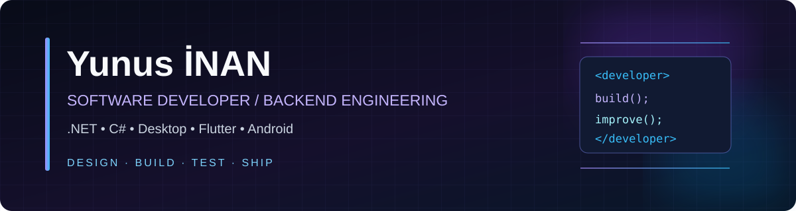
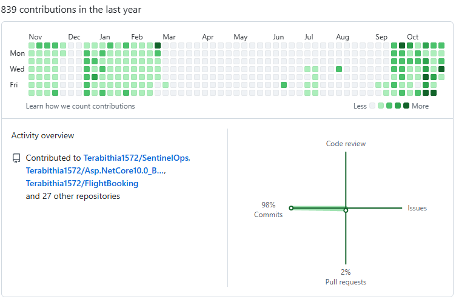

<div align="center">



<br />

[](https://github.com/Terabithia1572?tab=repositories)
[](https://www.linkedin.com/in/yunus-inan-550327214)
[](mailto:legendys65@gmail.com)


</div>

## 👨‍💻 About Me

I'm **Yunus İNAN**, a software developer from **Türkiye** building practical products across **backend engineering, desktop utilities, Android, and web applications**.

My core stack is **C# / ASP.NET Core**, with a strong interest in **Clean Architecture, APIs, data persistence, testing, security, and maintainability**. I also develop with **Flutter, WPF, React, and modern tooling**, taking projects from early prototypes to usable applications.

> **Build with purpose. Design for clarity. Test what matters. Keep improving.**

## ⚡ Technology & Engineering

<div align="center">

**Backend & Architecture**


**Data & Infrastructure**


**Web, Mobile & Desktop**


</div>

## 🚀 Featured Projects

*Selected public repositories, linked directly to their GitHub pages.*

| Project | What it does | Stack |
|:--|:--|:--|
| **[SentinelOps](https://github.com/Terabithia1572/SentinelOps)** | Security and operations tooling with a full-stack engineering focus | .NET · TypeScript · Docker |
| **[Movie API & Web Experience](https://github.com/Terabithia1572/Asp.NetCore9.0_Movie_API_Project)** | Movie and TV discovery experience with API-driven architecture | ASP.NET Core 9 · Web API |
| **[LabourPest](https://github.com/Terabithia1572/Asp.NetCore6.0_LabourPest_Project)** | Pest-control service platform with web and API components | ASP.NET Core · MVC · API |
| **[PitchCard Squad Builder](https://github.com/Terabithia1572/pitchcard-squad-builder)** | Football squad builder with customizable player cards | .NET · Web |
| **[QR Menu](https://github.com/Terabithia1572/Asp.NetCore9.0_QR_Menu_Project)** | Restaurant menu and management solution | ASP.NET Core 9 · Flutter |
| **[Windows Policy Manager](https://github.com/Terabithia1572/WindowsPolicyManager_V1)** | Windows policy and administration desktop utility | C# · WPF |
| **[FlightBooking](https://github.com/Terabithia1572/FlightBooking)** | Booking workflows and ASP.NET Core MVC patterns | ASP.NET Core · MVC |
| **[Terabithia Remote Desktop](https://github.com/Terabithia1572/Rust_TerabithiaRemote_Remote_Desktop_App)** | Custom-branded remote desktop application | Rust · Desktop |

<div align="center">

[](https://github.com/Terabithia1572?tab=repositories)

</div>

## 🧩 What I Work On

```text
BACKEND ENGINEERING      REST APIs · MVC · Authentication · EF Core · Dapper
SOFTWARE ARCHITECTURE    Clean / Onion Architecture · SOLID · Testing
DATA & INFRASTRUCTURE    SQL Server · PostgreSQL · SQLite · Docker
DESKTOP & SYSTEMS        WPF · Windows administration · Device management
MOBILE DEVELOPMENT       Flutter · Dart · Android integrations
WEB EXPERIENCES          React · TypeScript · Responsive interfaces
```

## 📈 GitHub Contributions

<div align="center">

<a href="https://github.com/Terabithia1572?tab=overview&from=2026-01-01&to=2026-12-31">
  
</a>

<sub>2026 activity snapshot captured on October 29, 2026 · 839 contributions shown for the preceding year at capture time. This image is not live-updating.</sub>

<br /><br />

[](https://github.com/Terabithia1572?tab=overview)

</div>

## 🤝 Let's Connect

Interested in backend architecture, cross-platform applications, developer tools, or collaborating on a project? Feel free to reach out.

<div align="center">

[](https://www.linkedin.com/in/yunus-inan-550327214)
[](https://www.instagram.com/yunusiinan/)
[](mailto:legendys65@gmail.com)

<br />

<sub>Designed & maintained by <b>Yunus İNAN</b> · Türkiye 🇹🇷</sub>

</div>
